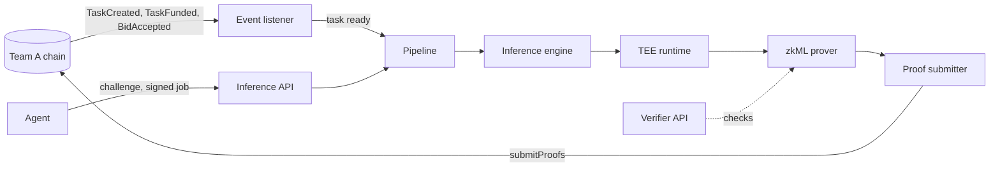

# Architecture

## The main flow

1. The **event listener** reads Team A's events from the chain and records each task's state.
2. When a task is ready (see `EXECUTION_TRIGGER` in [STATUS.md](STATUS.md)), the **pipeline**
   runs the model. Agents can also send work directly through the **inference API**.
3. The **inference engine** loads the model from the **model registry**, checks its hash, and
   runs it in a separate process (the **TEE runtime**, simulated in this build).
4. The **zkML prover** turns the execution into a proof. The **proof submitter** batches proofs
   and sends them to Team A's `submitProofs`.
5. The **verifier API** checks attestations and proofs for anyone who asks.

## The parts

| Part | Folder | What it does |
| --- | --- | --- |
| Shared | `src/common/` | Settings (`config.py`), data models, the model registry, storage backends (IPFS, 0G), sealing |
| Inference | `src/inference/` | Engine, sandbox, TEE runtime, the job API, auth, sealed keys, and the pipeline that wires everything |
| Proofs | `src/proof_generator/` | Development prover (not zero-knowledge) and the EZKL prover |
| Submission | `src/proof_submitter/` | Batching, retries, dead letters, alerts, and submission on chain |
| Listener | `src/event_listener/` | Polls the chain for task events, resumes after restarts, and detects chain changes |
| Verification | `src/verification/` | Checks TEE attestations and zkML proofs, by value or by reference |
| Federated learning | `src/federated_learning/` | Flower server and clients, FedAvg and other strategies, per-round provenance |

## Where state lives

All durable state is in Redis. Keys are prefixed by the component that owns them:

| Prefix | Owner | Holds |
| --- | --- | --- |
| `event_listener:last_block`, `event_listener:chain`, `event_listener:task:<id>` | Listener | Progress, the chain identity, and each task's events |
| `jobs:job:<id>`, `jobs:input:<id>`, `jobs:by_key:<task>:<hash>` | Job API | Job state, the input until the job finishes, and the idempotency index |
| `auth:nonce:<nonce>` | Auth | Single-use challenges, with a 120 s lifetime |
| `model:<id>:...`, `model:cid:<cid>` | Model registry | Model versions and the CID of each current version |
| `model_registry:upload_queue`, `model_registry:upload_failed` | Model registry | Uploads waiting for storage, and uploads that failed validation |
| `proof_submitter:dlq`, `proof_submitter:alerts` | Submitter | Dead-lettered proofs, and the alert record for each one |
| `fl:provenance:<task>` | FL orchestrator | One record per training round |

Model binaries live in storage (IPFS by default, or 0G). Uploads are spooled to
`data/upload_spool/` before the first attempt, so a restart does not lose them.

## Trust boundaries

- **The TEE is simulated.** The enclave is a software object with an in-memory signing key and a
  constant measurement. The model runs in a separate process, which the host can still read.
  See [STATUS.md](STATUS.md) for what this means for each requirement.
- **The chain is Team A's.** We read their contracts and call their functions. We never hold a
  copy of their rules.
- **Sealed models** are encrypted with a key read from a file. Only the simulated enclave decrypts
  them. No production path seals models yet.

## Services

`docker-compose.yml` runs one container per service, with these exceptions:

- The **pipeline** is one process that runs the listener, the engine, the prover and the submitter.
  Running the listener in two places would race on the same state.
- The **proof-submitter** container runs only the startup checks: chain id, and the prover
  allow-list when `CHECK_PROVER_ALLOWLIST` is set. It takes no proof traffic, because the pipeline
  submits proofs from its own process. Moving those checks into the pipeline is an open item in
  [STATUS.md](STATUS.md).

Images inherit from `docker/base.Dockerfile`, which installs the common dependencies and the 0G
storage CLI. EZKL is installed only where `INSTALL_ZKML=true`.
