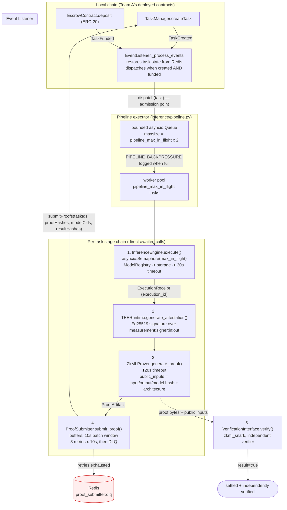
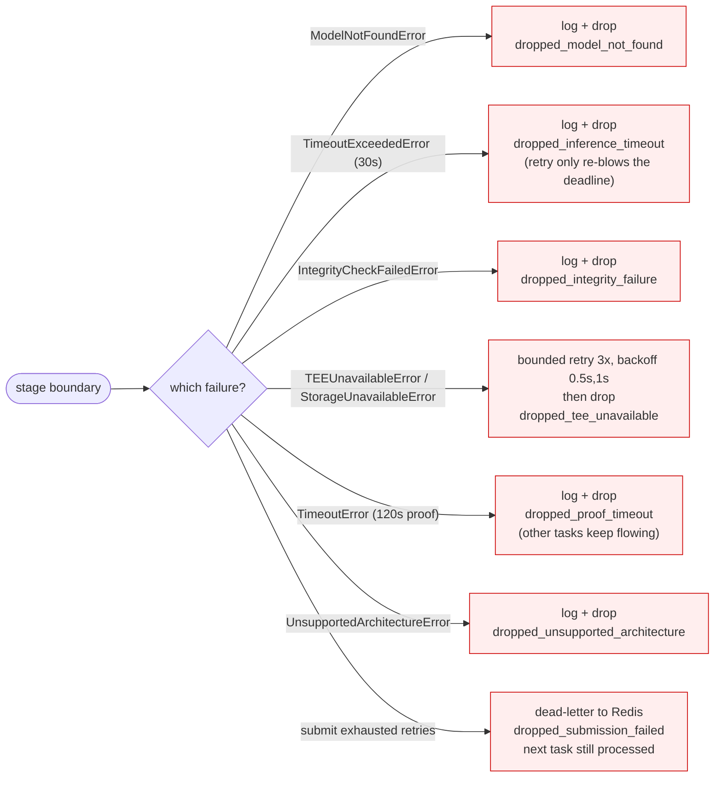
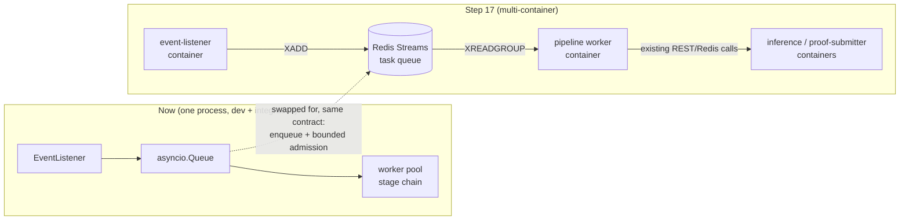

# Diagrams

Rendered from Mermaid source. Open this file on GitHub, or paste a block into
<https://mermaid.live>, to see the picture.

## End-to-end execution pipeline (as implemented)

This is the flow `inference/pipeline.py` actually runs. Stage boundaries are
labelled with the decision each one makes when a stage fails, because those
decisions — not the happy path — are what keep the poll loop alive.

## Failure decisions per stage boundary

## Step 17 seam: the same shape as separate containers

The queue is the only thing that changes. Because `Pipeline.enqueue` is already
the listener's dispatch target and the per-task stage chain is a plain awaited
call sequence, moving to Redis Streams replaces the transport without touching
stage logic.
